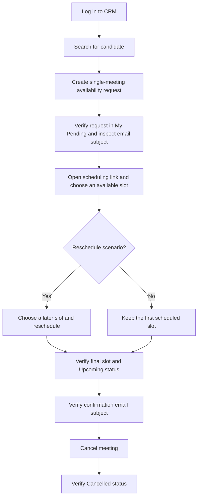

# Phenom CRM Interview Scheduling Automation

## Contents

- [Assignment overview](#assignment-overview)
- [Workflow and assertions](#workflow-under-test)
- [Repository structure](#repository-structure)
- [Architecture and fixtures](#architecture)
- [Setup](#setup)
- [Running the suite](#running-the-suite)
- [Reliability and test-data notes](#reliability-and-test-data-notes)
- [Likely interview questions and answers](#likely-interview-questions-and-suggested-answers)
- [Assignment discussion checklist](#assignment-discussion-checklist)

## Assignment overview

This repository contains a UI automation framework for testing the interview
scheduling workflow in the Phenom CRM UAT environment. It uses Python,
Playwright's synchronous API, pytest, and the Page Object Model (POM).

The main end-to-end scenario searches for a candidate, sends an interview
availability request, schedules a meeting from the candidate's response,
optionally reschedules it, verifies the meeting and confirmation email in the
CRM, then cancels the meeting and checks its final status.

The test currently uses these UAT records and settings:

- Candidate: `Pavan Chittala`
- Job: `Technical Lead` (the candidate's current job in the UAT environment)
- Interviewer: `aarthi.mupparthy@phenom.com`
- Meeting channel: Google Meet
- Meeting duration: 30 minutes
- Schedule window: 25 business days

These values are specific to the current assignment environment. Change them
in the test or move them to configuration if the target environment uses
different records.

## Workflow under test



### Assertions performed

| Stage | What the test checks |
| --- | --- |
| Login | The browser reaches the CRM host. The login smoke test also checks the current URL. |
| Interview setup | The “Schedule within” value is `25`. |
| Availability request | The request is visible under My Pending and its preview contains `Interview availability - Pavan Chittala - Technical Lead`. |
| Scheduler | The page reports that the interview was scheduled and a confirmation email was sent. The first scheduled slot is checked against the selected date and time. |
| Upcoming meeting | The meeting appears in the activity list with the expected final date, start time, and `Upcoming` status. |
| Confirmation email | The preview contains `Interview Confirmation - Pavan Chittala - Technical Lead`. |
| Cancellation | After cancellation, the meeting's status is `Cancelled`. |
| Reschedule case | The new slot differs from the original slot, and the final Upcoming row shows the new slot. |

The email checks read the CRM's **Preview Conversation** content. The suite
does not connect to a mailbox or independently verify SMTP delivery; it checks
the CRM email preview and the scheduler's success message.

## Repository structure

```text
.
├── pages/
│   ├── __init__.py              # Pages package marker
│   ├── base_page.py              # Shared navigation, click, and text-entry methods
│   ├── candidate_profile_page.py # Candidate profile actions
│   ├── dashboard_page.py         # Search, meeting activity, scheduling, and status actions
│   ├── interview_page.py         # Interview request creation and invitation
│   └── login_page.py             # Login page actions
├── resources/
│   └── meeting_infoTitle         # Counter used to generate meeting titles
├── tests/
│   ├── conftest.py               # Browser, context, page, and page-object fixtures
│   ├── test_dashboard.py         # Scheduled and rescheduled end-to-end cases
│   ├── test_framework_setup.py   # Application launch smoke check
│   └── test_login.py             # Login smoke test
├── utils/
│   ├── __init__.py              # Utilities package marker
│   ├── browser_factory.py        # Browser and context creation
│   ├── config_reader.py          # Reads environment variables and .env
│   └── wait_utils.py             # Shared visible-element wait
├── .env                          # Local credentials and run settings (create locally; ignored by Git)
├── pytest.ini                    # Pytest discovery, output, and markers
└── requirements.txt              # Python dependencies
```

`auth/auth_state.json` is created when the login test saves browser storage.
The `auth/` directory is ignored by Git because it contains an authenticated
session. Do not commit it.

## Architecture

### Page objects

- **`LoginPage`** contains login actions and inherits common operations from
  `BasePage`.
- **`CandidateProfilePage`** handles the profile menu and the “Invite to Job
  Interview” and “Single Meeting” actions.
- **`InterviewPage`** creates the availability request, selects the
  interviewer/channel/duration, verifies the schedule-window setup, configures
  communication, and sends the invite.
- **`DashboardPage`** handles candidate search, pending/upcoming activity,
  email preview, scheduling-link navigation, available-slot selection,
  rescheduling, and cancellation.
- **`BasePage`** contains the common navigation, click, and text-entry methods
  shared by page objects that inherit it.

The test module coordinates the business scenario and contains the
scenario-level assertions. Page objects also encapsulate checks closely tied
to their UI actions, such as confirming a selected slot or reading an email
subject from the preview.

### Pytest fixtures and browser lifecycle

`tests/conftest.py` provides these fixtures:

- `playwright_instance` starts Playwright for the test session.
- `browser` launches the configured browser once per test session.
- `browser_context` creates an isolated context for each test. If a readable
  saved storage state exists, it reuses it unless the test has the
  `force_login` marker; otherwise it creates a fresh context.
- `page` creates a page for each test and applies `DEFAULT_TIMEOUT`.
- `login_page` and `dashboard_page` provide page-object instances.
- `save_auth_state` saves the current context's browser storage under
  `auth/auth_state.json`.

The browser process is shared for the session, while each test gets its own
context and page. This gives tests separate cookies and browser storage.
The fixture supports `force_login` for tests that must start unauthenticated;
the current login test is not marked with it, so an existing saved session may
be reused on later runs. `force_login` is not yet registered in `pytest.ini`,
so add it to the marker list before using it to avoid an unknown-marker warning.

## Setup

Use the project's virtual environment when one is already configured. To set
up a new environment from the repository root:

```bash
python3 -m venv .venv
source .venv/bin/activate
python -m pip install --upgrade pip
python -m pip install -r requirements.txt
python -m playwright install chromium
```

Create a local `.env` file in the repository root. The file is ignored by Git.
Use your assigned UAT credentials; do not put real credentials in this README
or commit them.

```dotenv
BASE_URL=https://uat-pipeline.phenompeople.com/
BROWSER=chromium
HEADLESS=false
SLOW_MO=300
DEFAULT_TIMEOUT=15000
PHENOM_USERNAME=your-assigned-username
PHENOM_PASSWORD=your-assigned-password
```

`BASE_URL`, `PHENOM_USERNAME`, and `PHENOM_PASSWORD` must be set for the
current tests. The other values have defaults in `ConfigReader`:

| Variable | Default | Purpose |
| --- | --- | --- |
| `BASE_URL` | None | CRM UAT entry URL |
| `BROWSER` | `chromium` | Playwright browser type |
| `HEADLESS` | `false` | Run with or without a visible browser |
| `SLOW_MO` | `300` | Delay between browser actions, in milliseconds |
| `DEFAULT_TIMEOUT` | `15000` | Default Playwright page timeout, in milliseconds |
| `PHENOM_USERNAME` | None | UAT login username |
| `PHENOM_PASSWORD` | None | UAT login password |

To use a browser other than Chromium, set `BROWSER` to an installed Playwright
browser type and install that browser. For example: `python -m playwright install firefox`.
The current assignment is configured and exercised with Chromium.

## Running the suite

Run commands from the repository root with the virtual environment active.

```bash
# List the tests pytest discovers without opening a browser
pytest --collect-only -q

# Run the login smoke test
pytest -m smoke

# Run the dashboard end-to-end cases
pytest -m e2e

# Run one parametrized dashboard case
pytest 'tests/test_dashboard.py::TestDashboard::test_search_candidate[scheduled]'
pytest 'tests/test_dashboard.py::TestDashboard::test_search_candidate[rescheduled]'

# Run all collected tests
pytest
```

`pytest.ini` enables verbose output and `print` statements with `-v -s`. The
dashboard test is marked `e2e` and is parametrized into `scheduled` and
`rescheduled` cases. The `smoke` marker currently applies to the login test.
`regression`, `sanity`, `negative`, and `edge` are also registered markers, but
no current test uses them.

Optional report commands:

```bash
pytest --html=reports/report.html --self-contained-html
allure generate allure-results --clean -o allure-report
allure open allure-report
allure serve allure-results
```

Pytest now writes fresh Allure results to `allure-results/` on every run. The
report includes the local run start time, scenario metadata, workflow steps,
and browser screenshots and URLs when a test fails. Install the Allure command
line application separately to generate or open the HTML dashboard.

Run the dashboard cases sequentially. Both cases change CRM data for the same
candidate/job, and meeting names are generated by incrementing the shared
`resources/meeting_infoTitle` file. That counter is not designed for concurrent
workers, and parallel runs could also compete for available UAT slots. Although
`pytest-xdist` is installed, do not use `-n` for these stateful scenarios until
the test data and title generation are isolated per worker.

## How the end-to-end test works

1. Log in and search for the configured candidate.
2. Open the candidate profile in a popup and start a single interview request.
3. Generate a title such as `Tester<n>` from the `resources/meeting_infoTitle`
   counter. The counter is incremented for each case.
4. Select the interviewer, Online meeting type, Google Meet, and 30-minute
   duration. Check that the schedule window is set to 25 days.
5. Turn off SMS notification and send the availability request.
6. On the dashboard, find the meeting under My Pending and check the
   availability email subject in Preview Conversation.
7. Open the scheduling link. The scheduler helper searches forward from
   tomorrow for an enabled date and an available time slot, up to 60 days.
8. In the `rescheduled` case, open the scheduled interview's reschedule flow
   and choose a later date. The test checks that the returned slot differs
   from the original.
9. Return to the CRM and confirm the final slot and Upcoming status. Open the
   email preview and check the Interview Confirmation subject.
10. Cancel the meeting with the preferred “Candidate is withdrawn from the
    job” reason, open the all-meetings activity view, and verify `Cancelled`.

The scheduler's available dates and times are dynamic. The test does not
assume a fixed calendar date; it selects an available slot at runtime. The
scheduler helper retries when the selected slot is reported as unavailable.

## Reliability and test-data notes

- Page-object methods generally wait for controls to be visible before
  interacting. Playwright `expect` assertions also wait for the expected
  condition within their timeout.
- Candidate search retries up to three times when results do not appear.
- Slot selection scans dates instead of assuming that a particular date is
  open. Scheduling retries if the application rejects a selected slot as no
  longer available.
- The email is displayed in an iframe in Preview Conversation. The dashboard
  page object searches the frame content for the subject and scheduling link.
- The title counter is a mutable file and is not lock-protected. Keep these
  UAT tests sequential.
- The test cancels the meeting at the end of a successful scenario. If a run
  fails before cleanup, it can leave a pending or scheduled record in UAT; check
  the CRM before rerunning after a mid-flow failure.
- `test_framework_setup.py` currently opens the application and prints its URL
  and title. It is a launch smoke check, but it does not currently contain an
  assertion.

## Likely interview questions and suggested answers

Use these as talking points and adapt them to your own contribution. The answers
describe the framework as it currently exists.

### Project and design

**1. What does this automation project test?**

It tests the interview scheduling lifecycle in the Phenom CRM UAT environment.
The workflow creates an availability request, schedules a slot, optionally
reschedules it, checks the resulting Upcoming meeting and confirmation email,
then cancels it and checks the final status.

**2. Why did you choose Playwright and pytest?**

Playwright provides browser automation, popup and iframe handling, locator
waiting, and retrying assertions. Pytest provides test discovery, fixtures,
markers, and parametrization, which let the scheduled and rescheduled cases
share one workflow without duplicating the entire test.

**3. What is the Page Object Model, and how is it used here?**

POM groups page-specific locators and browser actions into classes. For example,
`InterviewPage` owns interview setup actions and `DashboardPage` owns dashboard
and meeting actions. The test reads as a business workflow instead of repeating
selectors and low-level browser calls at every step.

**4. What belongs in a page object versus a test?**

Reusable actions and UI-specific details belong in page objects. The test
coordinates multiple pages and scenarios and expresses business expectations.
This codebase also keeps some UI-level checks in page objects when the check is
tightly coupled to the action, such as confirming a scheduler response or
reading an email subject.

**5. Why have a `BasePage`?**

It provides shared operations used by the login and interview page objects,
such as navigation, clicking, and entering text. Keeping common behavior in one
place avoids duplicating those small methods. Page objects that do not need the
shared behavior can remain independent, as `DashboardPage` currently does.

**6. How is the project organized?**

`pages/` contains page objects, `tests/` contains pytest scenarios and fixtures,
`utils/` contains browser/configuration/wait helpers, and `resources/` contains
the meeting-title counter. Credentials and run settings are loaded from the
local `.env` file.

### Pytest and browser lifecycle

**7. What is a pytest fixture? Which fixtures does this project use?**

A fixture prepares and provides reusable test dependencies. Here, fixtures
start Playwright, launch a browser, create an isolated context and page, and
provide the `LoginPage` and `DashboardPage` objects. A separate fixture saves
authentication storage after login.

**8. Why is the browser session-scoped but the context function-scoped?**

Launching a browser process is relatively expensive, so it is reused for the
test session. A new browser context per test isolates cookies and local storage
so one test's session changes do not leak into another test.

**9. How does authentication state reuse work?**

The context fixture checks for `auth/auth_state.json`. If it contains readable
JSON and the test has not requested a forced login, the context is created from
that state. Otherwise, the test gets a fresh context. The login test saves the
state after successful navigation.

**10. What does parametrization do in the dashboard test?**

The `should_reschedule` parameter runs the same main workflow twice: once with
the initial scheduled slot and once with a reschedule. This keeps setup and
verification consistent while exercising both paths.

**11. How would you run only one parametrized case?**

Use its pytest node ID, for example:
`pytest 'tests/test_dashboard.py::TestDashboard::test_search_candidate[rescheduled]'`.
Quoting the node ID protects the square brackets from shell pattern expansion.

**12. Why should these tests not run in parallel currently?**

They update the same UAT candidate/job and share a file-based title counter.
The counter does not use a lock or worker-specific value, and both runs consume
real scheduler slots. Parallel workers could collide or make the results
unreliable.

### Playwright techniques

**13. How do you handle the candidate profile opening in a new tab?**

The test wraps the profile-link click in `page.expect_popup()`, then uses the
returned popup page. This ties the popup to the action and avoids guessing
which browser page was opened.

**14. How do you handle an email displayed in an iframe?**

`DashboardPage` inspects the frames associated with Preview Conversation, finds
the frame containing the requested subject, and checks its body. It also looks
for the scheduling link in the email frame before opening the link in a new
page.

**15. How do you deal with dynamic calendar availability?**

The test starts at tomorrow, checks date cells for enabled/non-disabled state,
then looks for visible and enabled time slots. If a day or slot is unavailable,
it tries a later date rather than relying on a hard-coded date.

**16. How does the reschedule path verify that the meeting changed?**

It passes the first slot to the reschedule flow, asks the scheduler for a later
slot, and asserts that the returned slot differs from the original. It then
checks the final date, time, and Upcoming status in the CRM.

**17. How does the test handle a scheduling slot that becomes unavailable?**

After submitting, it checks the scheduler response. If the response says no
slots are available, it searches again after the prior date and retries up to
four scheduling attempts. Other failures raise an error with response text to
make the cause easier to diagnose.

**18. What is the difference between a fixed sleep and an explicit wait?**

A fixed sleep waits for a set duration even if the page is ready sooner. An
explicit wait waits for a specific state, such as an element becoming visible
or a response appearing. This project mostly uses Playwright locator waits and
retrying `expect` assertions, but it still has a few fixed waits that could be
replaced with state-based conditions.

**19. How do Playwright assertions help with timing?**

Assertions such as `expect(locator).to_be_visible()` retry until the condition
passes or the timeout expires. That is more reliable for asynchronous UI updates
than reading a value immediately after a click.

**20. What locator strategies are used?**

The page objects use CSS selectors, IDs, XPath, text, and accessible roles.
For long-term stability, prefer role/label-based locators or stable test IDs
when the application exposes them; selectors tied to generated or positional
IDs are more likely to need maintenance.

### Assertions and test strategy

**21. How do you prove the invite was sent?**

The test checks that the CRM shows the meeting under My Pending and that Preview
Conversation contains the expected availability email subject. It then
completes scheduling and checks the scheduler's message that a confirmation
email was sent, followed by the confirmation email subject in the CRM preview.
This verifies application UI evidence, not delivery to an external mailbox.

**22. Why check both the meeting slot and the email subject?**

They validate separate outcomes. The slot/status assertion verifies the CRM
record reflects the selected schedule; the subject assertion verifies that the
expected communication is present in the meeting activity preview.

**23. How do you verify cancellation?**

The test opens the meeting's actions, selects a cancellation reason, confirms
the cancellation, reloads the all-meetings activity view, and checks for an
exact `Cancelled` status on the meeting row.

**24. What is a smoke test in this repository?**

`test_login.py` is marked `smoke` and verifies successful login by checking the
CRM URL. `test_framework_setup.py` opens the application and prints its URL and
title, but it currently has no assertion. The dashboard workflow is marked
`e2e` because it crosses several CRM pages and the scheduler.

**25. Is the test data fully data-driven?**

Not yet. Candidate, job, and interviewer values are currently defined in the
dashboard test or page object, and the title uses a counter file. A future
improvement would move environment-specific records into a validated
configuration/data source and provide a unique title per test run.

**26. What happens if a test fails before cancellation?**

The cleanup action is at the end of the successful test path, so an earlier
failure can leave an invite or scheduled meeting in UAT. I would inspect the
CRM and clean up that record before rerunning. A stronger implementation could
add a teardown/finalizer that attempts cleanup without masking the original
failure.

### Configuration, reliability, and improvements

**27. How are credentials protected?**

`ConfigReader` loads credentials from environment variables or the local `.env`
file. `.env` and the generated `auth/` directory are ignored by Git. Real
credentials and browser storage should never be committed.

**28. How would you run this in CI?**

Install the requirements and Chromium, provide the UAT URL and credentials as
secret environment variables, set `HEADLESS=true`, and run the tests
sequentially. A CI job should keep reports and traces as artifacts while never
publishing `.env` or authentication state.

**29. What are the main reliability risks?**

The test depends on a live UAT account, specific candidate/job data, current UI
selectors, real scheduler availability, and email preview content. The shared
title counter and real CRM mutations also make parallel execution unsafe. These
risks should be addressed with isolated test data and better cleanup before
scaling the suite.

**30. What would you improve next?**

I would replace remaining fixed sleeps with UI-state waits, add failure-safe
cleanup for created meetings, move candidate/job/interviewer data into explicit
configuration, make meeting IDs safe for parallel workers, improve selector
stability with test IDs, and capture screenshots/traces on failure. I would
also add a real assertion to the application-launch smoke test and configure
HTML or Allure reporting explicitly if the assignment requires reports.

**31. Why are pytest-html, Allure, and xdist in the requirements?**

They are available for reporting and parallel-test workflows, but they are not
configured as default pytest reports in this repository. HTML and Allure
reports require explicit command options/configuration. Xdist should not be
used for the current stateful dashboard cases until test data and title
generation are isolated.

**32. How does the test find the right pending scheduling request?**

It opens the job group and first filters request cards by the generated meeting
title. If that does not identify a card, it extracts the `schedulingRequestId`
from the `llt` query parameter and uses the ID to find a matching request. It
falls back to the first request in the job group if neither lookup finds a
match, which is a place to improve if the environment can contain several
similar pending requests.

**33. How is a unique meeting title generated?**

`InterviewPage` reads an integer from `resources/meeting_infoTitle`, increments
it, writes it back, and uses a title like `Tester<n>`. This makes titles
distinguishable across sequential runs, but the file is not concurrency-safe.
A timestamp, UUID, or test-run identifier would be safer for parallel or
distributed execution.

**34. Does the test prove that the candidate received the email?**

No. It checks the email subject in the CRM's Preview Conversation and checks
the scheduler's confirmation message. To prove mailbox delivery, I would add a
controlled test mailbox or mail-service API check and correlate the message to
the generated meeting title or a unique test-run value.

**35. Why use a UI end-to-end test for this workflow?**

The assignment is about the recruiter and candidate scheduling journey across
the CRM, email preview, and scheduler. A UI test verifies that these pieces
work together from the user's perspective. I would complement it with API or
service-level tests for narrower rules because those are faster and less
dependent on UI timing.

**36. What would you do if the test failed intermittently?**

I would identify the failing step and inspect the page URL, visible response,
and current meeting state first. Then I would replace fixed sleeps with
condition-based waits, check whether a scheduler slot became unavailable, and
capture a screenshot or Playwright trace on failure. I would avoid adding a
blind retry around the whole test because that can hide a real product or data
problem and create duplicate UAT records.

**37. What happens if no slot is available in the search window?**

The date-selection helper scans from tomorrow through the next 60 days and
raises a `RuntimeError` if it finds no enabled date with an available time.
That failure is preferable to silently choosing an invalid or unrelated slot.

## Assignment discussion checklist

Before presenting or running the project, confirm that:

- The `.env` file contains valid UAT credentials and the intended base URL.
- The assigned candidate, job, and interviewer are available in that UAT
  environment.
- The CRM is checked for leftover pending or scheduled meetings from an earlier
  failed run.
- The test is run sequentially so the shared title counter and scheduler slots
  do not collide.
- You can explain the distinction between the availability email preview and
  the post-scheduling confirmation email preview.
